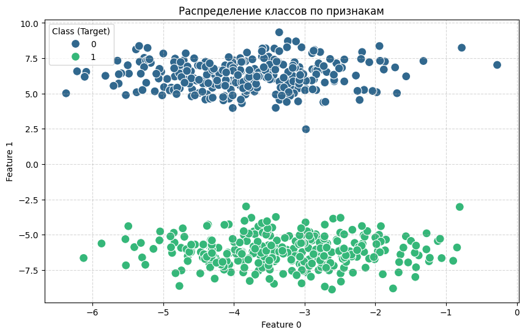
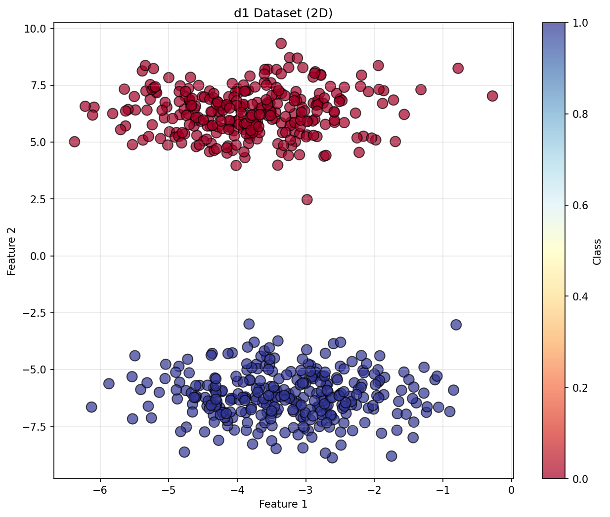
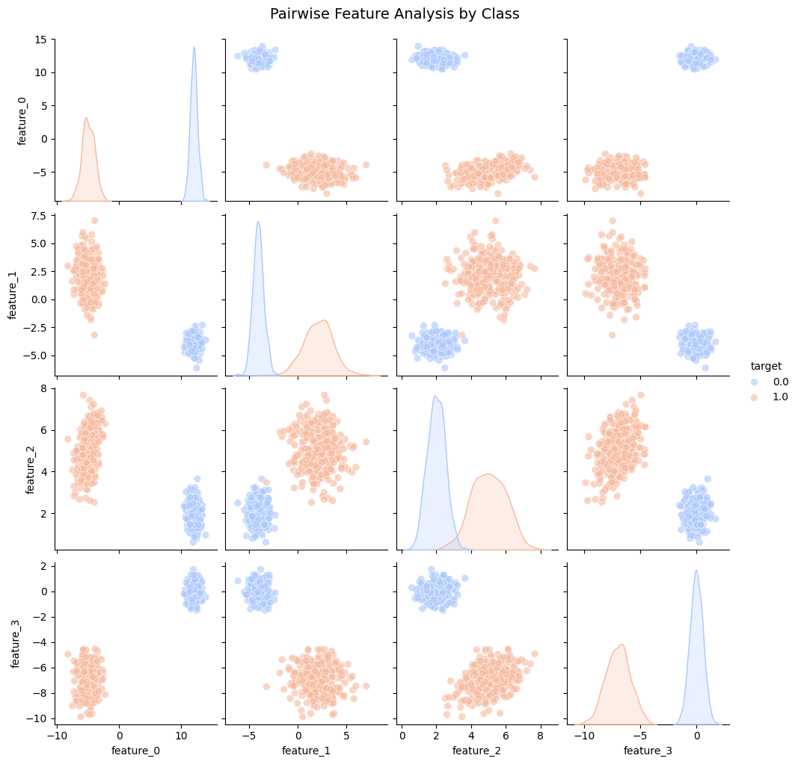
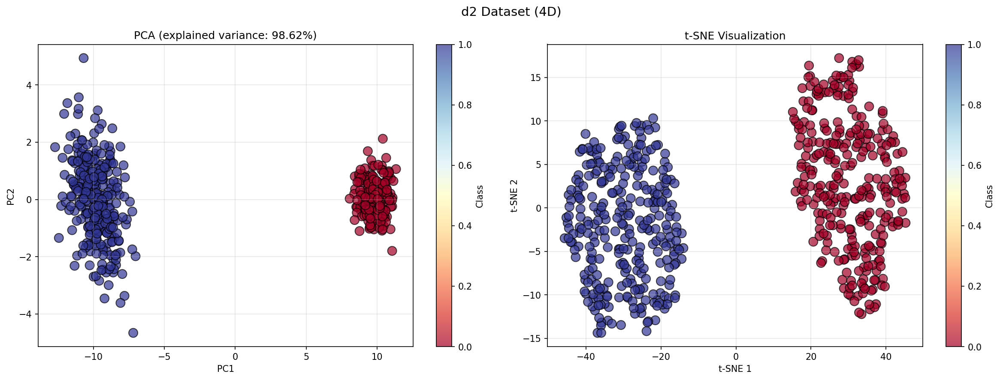
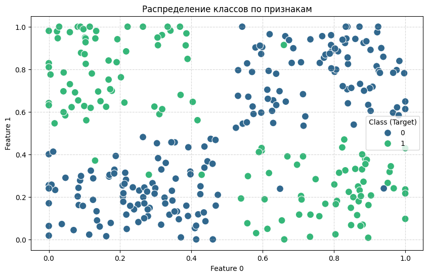
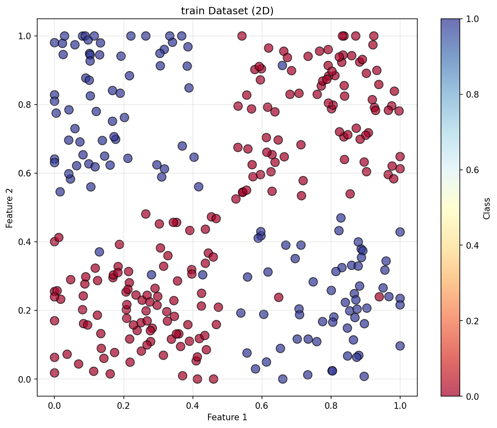

# Neural Perceptron

<div align="center">

**Нейронная сеть на C++17 с градиентным и генетическим обучением**

Реализация полносвязной нейронной сети с собственной математической инфраструктурой, оценкой качества классификации, визуализацией результатов и Python bindings.

[Возможности](#возможности) · [Сборка](#сборка) · [Запуск](#запуск) · [Тесты](#тестирование) · [Структура](#структура-проекта) · [Вклад в проект](CONTRIBUTING.md)


</div>

---

## О проекте

Проект — учебная реализация нейронной сети для задач классификации. Основная логика написана на **C++17**: от векторов и матриц до слоёв сети, алгоритмов обучения и метрик. Дополнительно доступны Python-скрипты для запуска экспериментов и анализа данных.

Репозиторий содержит исходный код, CSV-датасеты, модульные тесты и примеры визуализаций.

## Возможности

- **Нейронная сеть:** настраиваемая архитектура по числу нейронов в слоях, прямой проход и предсказание класса.
- **Градиентное обучение:** mini-batch, L2-регуляризация, перемешивание выборки и ранняя остановка.
- **Генетическое обучение:** популяция кандидатов, отбор, скрещивание, мутации и элитизм.
- **Оценка качества:** accuracy, precision, recall и F1-метрики.
- **Работа с данными:** чтение и запись CSV, поддержка разного количества признаков и генератор XOR.
- **Визуализация:** наборы данных, результаты классификации, PCA/t-SNE и история обучения.
- **Python bindings:** возможность вызывать C++-логику из Python через pybind11.
- **Тесты:** отдельные тесты для математических утилит, загрузки данных, сети, тренеров и метрик.

## Как это устроено

Обучение выполняется выбранным тренером. Он меняет веса сети, оценивает результат на данных и предоставляет историю обучения и метрики. В реализации предусмотрены два подхода:

| Алгоритм | Идея | Когда полезен |
|---|---|---|
| Градиентный спуск | Обновляет веса по градиенту функции потерь | Для классического обучения с настройкой learning rate и mini-batch |
| Генетический алгоритм | Эволюционно улучшает популяцию наборов весов | Для сравнения альтернативного подхода к оптимизации |

Общая схема:

`CSV → DataSet → NeuralNetwork → Trainer → Metrics / Visualization`

## Демонстрационные результаты

Примеры графиков, сохранённых в репозитории:

### Датасет d1

| Исходные данные | Результат |
|---|---|
|  |  |

### Датасет d2

| Исходные данные | Результат |
|---|---|
|  |  |

### Обучающая выборка

| Исходные данные | Результат |
|---|---|
|  |  |

> Графики демонстрируют примеры визуализации. Не следует воспринимать их как универсальную оценку качества модели на любых данных.

## Требования

Для сборки C++-части:

- C++17-совместимый компилятор (GCC, Clang или MSVC);
- CMake 3.15 или новее;
- Git — для загрузки pybind11 через CMake FetchContent.

Для Python-скриптов и визуализации: Python 3.8+ и зависимости из `requirements.txt`.

## Сборка

### 1. Клонировать репозиторий

```bash
git clone https://github.com/l1234-tech/neural-perceptrone.git
cd neural-perceptrone
```

### 2. Создать каталог сборки и собрать проект

```bash
cmake -S . -B build
cmake --build build --config Release
```

При конфигурации CMake скачивает pybind11 через FetchContent, поэтому для этого шага требуется доступ к сети.

CMake создаёт исполняемый файл `main`, тестовый запускатель `test_runner` и Python-модуль `nnlib`. На Windows расположение исполняемых файлов зависит от генератора и конфигурации сборки; часто это `build/Release/` или `build/Debug/`.

## Запуск

### Основная C++-демонстрация

После сборки запусти программу из корня репозитория. Расположение исполняемого файла зависит от платформы и выбранного генератора.

Linux/macOS, если файл находится в `build/main`:

```bash
./build/main
```

Windows, если используется Visual Studio:

```powershell
.\build\Release\main.exe
```

Программа содержит демонстрационные сценарии обучения и анализа данных. Некоторые пути к данным разрешаются относительно рабочего каталога, поэтому запускай её из корня проекта, если код явно не задаёт другой путь.

### Python-скрипт с примерами

После сборки Python-модуль `nnlib` должен быть доступен для импорта. Установи Python-зависимости:

```bash
python -m venv .venv
```

Активация виртуального окружения:

- Windows PowerShell: `.\.venv\Scripts\Activate.ps1`
- Linux/macOS: `source .venv/bin/activate`

Далее:

```bash
python -m pip install -r requirements.txt
python python_scripts_example.py
```

Пример использует настройки в начале `python_scripts_example.py`: тип тренера, архитектуры сетей, наборы данных и параметры обучения.

### Python-скрипт для экспериментов

Скрипт `scripts/run_model.py` поддерживает дополнительные параметры. Посмотреть актуальный интерфейс:

```bash
python scripts/run_model.py --help
```

Например, запрос справки не запускает обучение и помогает проверить доступные параметры конкретной версии скрипта.

## Тестирование

Тесты собраны в CMake-цели `test_runner`. После сборки из корня репозитория:

Linux/macOS:

```bash
./build/test_runner
```

Windows / Visual Studio:

```powershell
.\build\Release\test_runner.exe
```

Если сборка использует другой генератор или конфигурацию, поправь путь к файлу в соответствии с содержимым `build/`.

## Структура проекта

```text
.
├── CMakeLists.txt                 # Сборка библиотеки, приложения, тестов и Python-модуля
├── main.cpp                       # C++-демонстрация
├── python_scripts_example.py      # Пример использования из Python
├── include/                       # Заголовочные файлы
│   ├── data/                      # Загрузка и структуры датасетов
│   ├── metrics/                   # Метрики классификации
│   ├── neural_network/            # Сеть, слои и функции активации
│   ├── trainer/                   # Интерфейсы и алгоритмы обучения
│   ├── utils/                     # Векторы, матрицы и случайные числа
│   └── visualization/             # Интерфейс визуализации
├── src/                           # Реализация модулей на C++
├── tests/                         # Модульные тесты
├── scripts/                       # Python-скрипты экспериментов
│   └── results/                   # Примеры полученных графиков
├── data/                          # CSV-датасеты
├── images/                        # Иллюстрации исходных наборов данных
├── requirements.txt               # Python-зависимости
└── .sourcecraft/                  # CI для SourceCraft
```

## Где что менять

- Архитектура, прямой проход и предсказание: `include/neural_network/` и `src/neural_network/`.
- Алгоритмы обучения: `include/trainer/` и `src/trainer/`.
- Формат и загрузка данных: `include/data/` и `src/data/`.
- Метрики: `include/metrics/` и `src/metrics/`.
- Визуализация: `include/visualization/` и `src/visualization/`.
- Python-интерфейс: `src/python_bindings.cpp`.
- Проверка поведения: `tests/`.

## Разработка и вклад

Инструкции по структуре кода, сборке, тестированию и подготовке изменений находятся в [CONTRIBUTING.md](CONTRIBUTING.md).

## CI

В репозитории присутствует конфигурация SourceCraft CI в `.sourcecraft/ci.yaml`, в которой предусмотрены сборка проекта через CMake и запуск `test_runner`. Фактический запуск CI зависит от конфигурации SourceCraft для репозитория.

## Примечания

- Файл `nnlib.pyd` в корне — скомпилированный Python-модуль для конкретной платформы и версии Python. Для переносимой сборки предпочтительно собирать модуль локально через CMake.
- Каталоги `build/` и другие локальные артефакты сборки не нужно коммитить.
- Датасеты в `data/` и сохранённые графики в `scripts/results/` оставлены на месте, поскольку они используются как примеры и иллюстрации.

---

<div align="center">

**C++17 · Neural Networks · Optimization · Classification**

</div>
